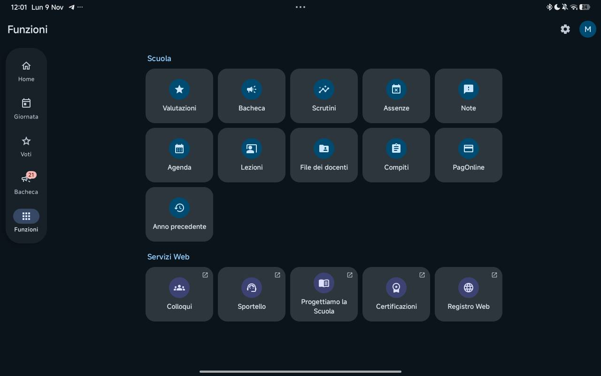
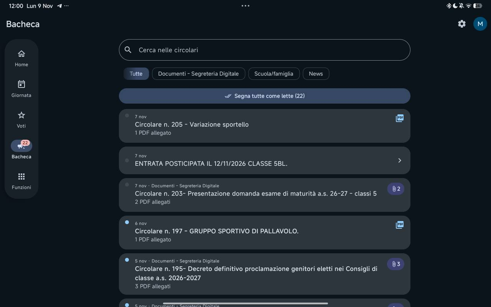

# CV Next

**Il registro scolastico, a colpo d’occhio.**

Client non ufficiale per ClasseViva · Android e iOS

[Scarica Android](https://github.com/yzypablo67/CV-Next/releases/latest/download/CV-Next.apk) · [Anteprima iOS](https://github.com/yzypablo67/CV-Next/releases/tag/ios-v0.1.0) · [Segnala un problema](https://github.com/yzypablo67/CV-Next/issues)

## Scegli la versione

| | Android | iPhone e iPad |
|---|---|---|
| Versione | **1.6.14**, progetto recuperato | **0.1.0**, anteprima nativa |
| Requisiti | Android 8.0+ | iOS / iPadOS 17+ |
| Interfaccia | Material You, colori dinamici | SwiftUI, Liquid Glass su iOS 26 |
| Installazione | APK firmato | IPA da firmare con AltStore/Sideloadly |
| Codice | [Branch main](https://github.com/yzypablo67/CV-Next/tree/main) | [Branch ios](https://github.com/yzypablo67/CV-Next/tree/ios) |
| Guida | [Funzioni e build Android](docs/ANDROID.md) | [Guida iOS](ios/README.md) |

> La versione iOS è all’inizio del porting: non comprende ancora tutte le funzioni Android. Un IPA non firmato non si installa direttamente da Safari o File.

## Android

Voti e medie, giornata scolastica, compiti, circolari, documenti e notifiche in un’interfaccia adattata a telefono e tablet.

  

Screenshot reale fornito dall’autore: schermata Funzioni, tablet, tema scuro. Riferimento visivo dell’app; può precedere gli ultimi ritocchi.

Altra schermata Android: Bacheca

### Cosa trovi nell’app

| Area | Funzioni |
|---|---|
| **Home e giornata** | Prossime verifiche, lezioni, compiti, promemoria, ultimi voti e avvisi |
| **Voti** | Periodi scolastici, media generale e per materia, grafici e calcolo del voto necessario |
| **Bacheca** | Ricerca e filtri, comunicazioni non lette, lettura e condivisione dei PDF |
| **Registro** | Assenze, note, scrutini, lezioni e materiale dei docenti |
| **Account e aspetto** | Più account, temi chiaro/scuro, colori dinamici e palette selezionabili |
| **Notifiche** | Novità del registro e promemoria serale configurabile |

L’elenco completo, i limiti del recupero e le istruzioni tecniche sono nella [guida Android](docs/ANDROID.md).

### Installare o aggiornare

1. [Scarica `CV-Next.apk`](https://github.com/yzypablo67/CV-Next/releases/latest/download/CV-Next.apk).
2. Aprilo e consenti l’installazione da quella sorgente, se Android lo richiede.
3. Dalla versione **1.6.12 di questa repository**, gli aggiornamenti usano la stessa firma: puoi installarli sopra la versione precedente.

L’app originale e la prima ricostruzione con firma debug usano chiavi differenti. Non possono essere aggiornate direttamente con questi APK; un’eventuale disinstallazione cancella i dati locali.

## iOS

Il porting usa SwiftUI e i materiali nativi di Apple: **Liquid Glass su iOS 26**, superfici traslucide sulle versioni precedenti e supporto a Riduci trasparenza.

Disponibili nella prima anteprima: login, scelta dello studente, Home, Voti per periodo, medie, dettaglio materia, lista Bacheca con ricerca e modalità demo. Agenda, PDF, notifiche e altre funzioni sono ancora in sviluppo.

**[Apri la guida iOS e le istruzioni di firma →](ios/README.md)**

## Compilazioni e download

- **Android:** [workflow Build Android APK](https://github.com/yzypablo67/CV-Next/actions/workflows/release.yml). I tag `v*` pubblicano l’APK nelle release.
- **iOS:** [workflow Build iOS IPA](https://github.com/yzypablo67/CV-Next/actions/workflows/ios.yml). Ogni build riuscita offre l’artifact `CV-Next-iOS-unsigned`; i tag `ios-v*` pubblicano prerelease separate.
- Gli artifact GitHub sono ZIP: estraili per trovare APK o IPA. Per scaricarli può essere necessario accedere a GitHub.

## Stato del progetto

La versione Android è stata recuperata da un APK dopo la perdita di accesso alla repository originale. Il codice compilabile recuperato è **Smali**, non il progetto Kotlin/Gradle originale. iOS è invece un progetto **SwiftUI nativo** scritto per il porting.

Build e test automatici sono disponibili su GitHub Actions. Questo non sostituisce una verifica delle funzioni su dispositivo o con un account ClasseViva reale.

## Segnalazioni

[Apri una issue](https://github.com/yzypablo67/CV-Next/issues) indicando versione dell’app, sistema operativo, passaggi per riprodurre il problema e comportamento atteso. Oscura nomi, voti e altri dati personali negli screenshot. Non allegare password, token o chiavi di firma.

## Crediti

Progetto originale `mattcoc/cv-next`, recupero e sviluppo su `yzypablo67/CV-Next`.

CV Next è un progetto non ufficiale, non affiliato, sponsorizzato o approvato da Gruppo Spaggiari Parma S.p.A. ClasseViva e gli altri marchi appartengono ai rispettivi titolari. Le dipendenze conservano le rispettive licenze; non viene attribuita una nuova licenza al codice recuperato.
